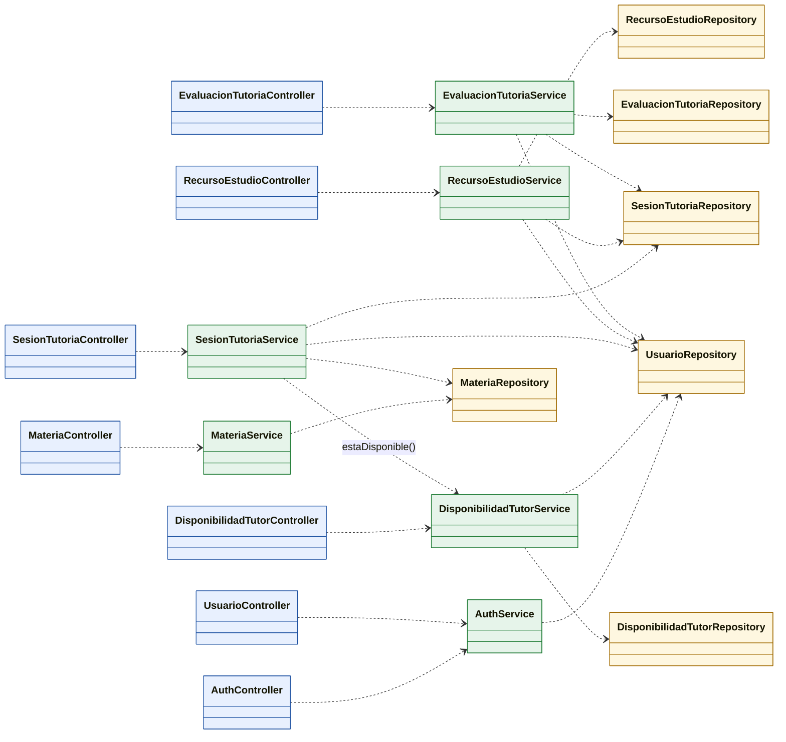
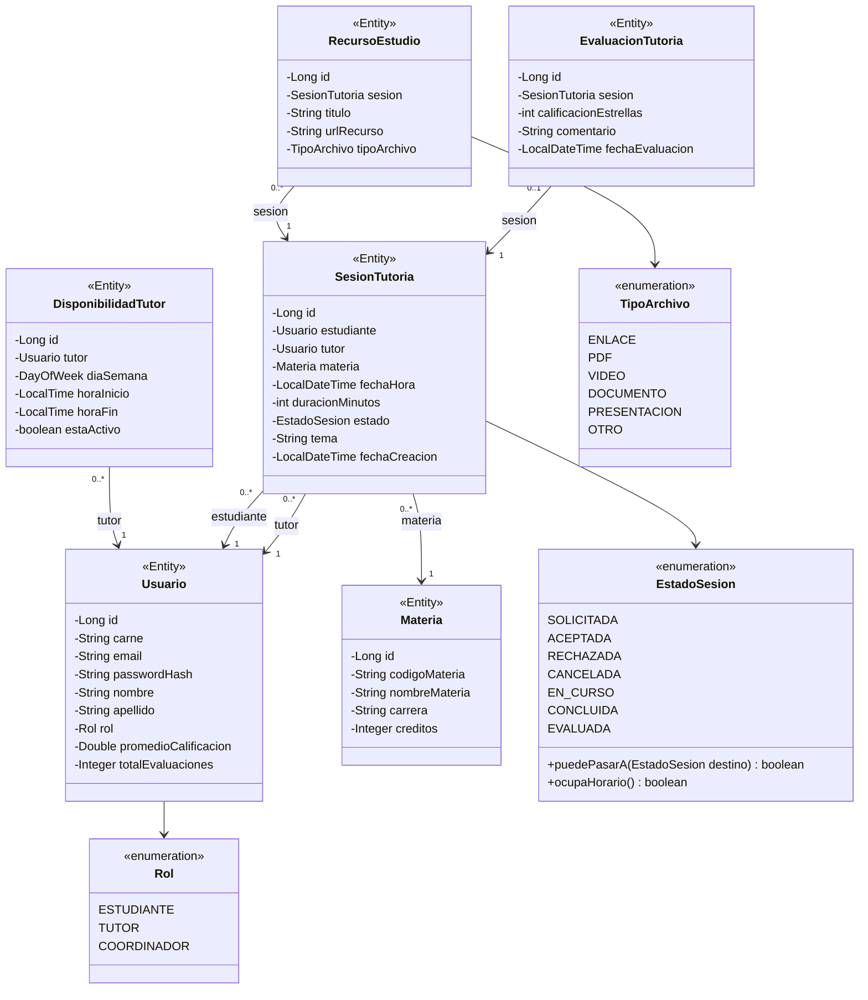
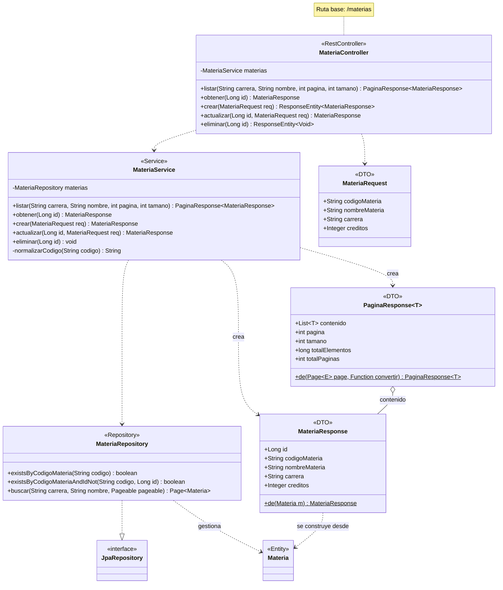
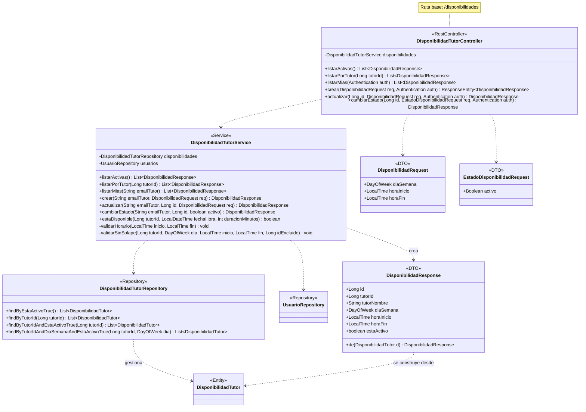
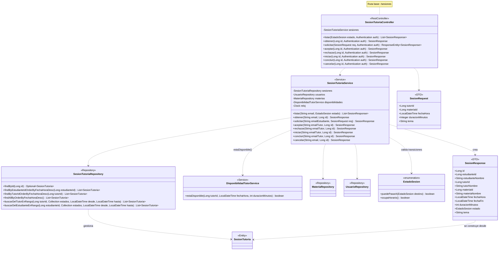
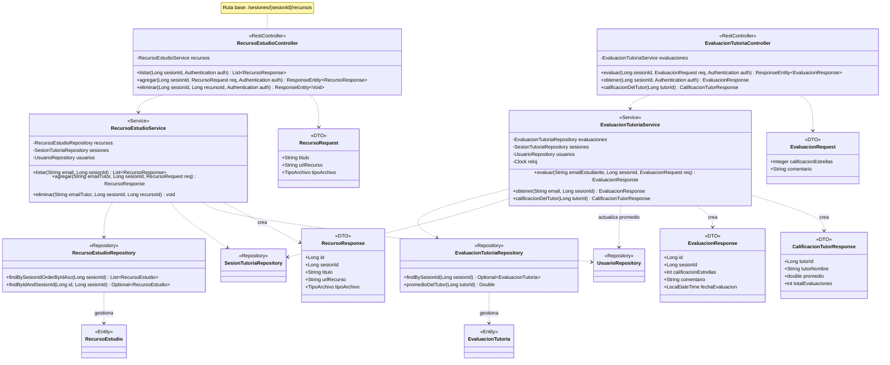
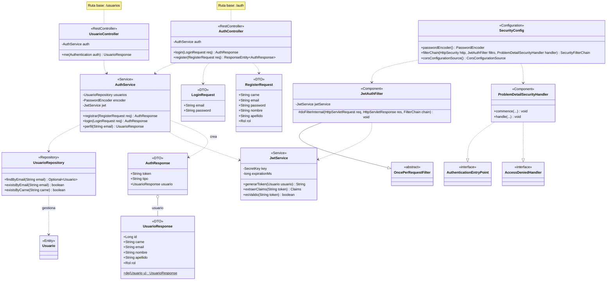
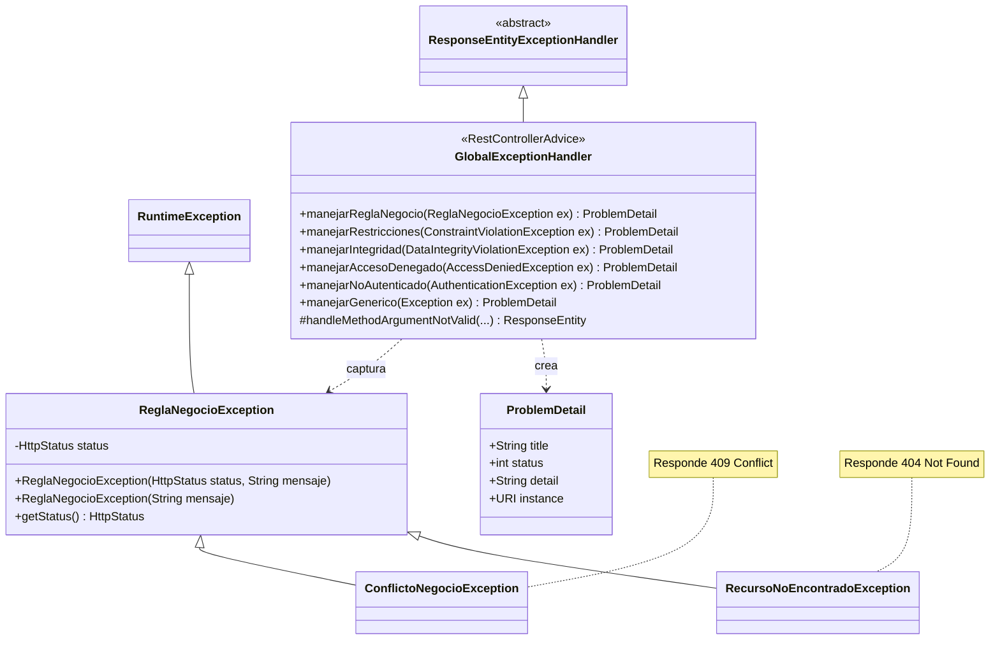

# Diagrama de Clases UML del Backend

Modelado de la arquitectura en capas de Spring Boot:
**Controller → Service → Repository → Entity**, con los DTOs que viajan entre el cliente y la API.

Para que se pueda leer, el diagrama se divide en varias vistas:

1. [Vista general por capas](#1-vista-general-por-capas)
2. [Modelo de dominio (entidades `@Entity`)](#2-modelo-de-dominio)
3. [Materias](#3-materias)
4. [Disponibilidad del tutor](#4-disponibilidad-del-tutor)
5. [Sesiones de tutoría](#5-sesiones-de-tutoría)
6. [Recursos y evaluaciones](#6-recursos-y-evaluaciones)
7. [Autenticación y seguridad](#7-autenticación-y-seguridad)
8. [Manejo de errores RFC 7807](#8-manejo-de-errores-rfc-7807)

**Notación**

| Relación | Símbolo | Significado en este proyecto |
|---|---|---|
| Dependencia | `..>` | Una clase usa a otra (por ejemplo, el controlador llama al servicio, o crea un DTO) |
| Asociación | `-->` | Una entidad referencia a otra con `@ManyToOne` / `@OneToOne` |
| Agregación | `o--` | Un DTO contiene a otro DTO o una lista de ellos |
| Herencia | `<\|--` | `extends` |
| Realización | `..\|>` | `implements` |

Estereotipos: `<<Entity>>`, `<<Repository>>`, `<<Service>>`, `<<RestController>>`, `<<DTO>>` (records de Java) y `<<enumeration>>`.

---

## 1. Vista general por capas

Cada controlador solo conoce a su servicio; cada servicio usa repositorios (nunca otros controladores).
La única dependencia entre servicios es `SesionTutoriaService → DisponibilidadTutorService.estaDisponible(...)`.

---

## 2. Modelo de dominio

Entidades JPA (`@Entity`) con sus atributos y asociaciones. Todas las relaciones `@ManyToOne` /
`@OneToOne` usan `FetchType.LAZY`; los repositorios las cargan con `@EntityGraph` cuando se
necesitan, para evitar el problema de consultas N+1.

---

## 3. Materias

Catálogo de asignaturas. Lectura para cualquier usuario autenticado; crear, editar y eliminar
solo para el COORDINADOR (`@PreAuthorize`). La regla "código único" vive en el servicio.

---

## 4. Disponibilidad del tutor

Bloques del horario semanal. Solo el TUTOR crea y modifica sus propios bloques. El servicio valida
que la hora de fin sea posterior a la de inicio y que no haya solapes
(`inicioA < finB && inicioB < finA`) entre bloques activos del mismo tutor y día.
`estaDisponible(...)` es el contrato que usa `SesionTutoriaService` al reservar.

---

## 5. Sesiones de tutoría

Flujo principal y máquina de estados. El servicio valida transiciones (`EstadoSesion.puedePasarA`),
traslapes de horario del tutor y del estudiante, la disponibilidad del tutor y la cancelación con
al menos 2 horas de anticipación. `Clock` se inyecta para poder probar la regla de tiempo.

---

## 6. Recursos y evaluaciones

Cierre del flujo de una sesión. El tutor asocia recursos a sus sesiones; el estudiante evalúa una
sesión CONCLUIDA (una sola vez), la sesión pasa a EVALUADA y se recalcula el promedio del tutor
(`Usuario.promedioCalificacion` y `Usuario.totalEvaluaciones`).

---

## 7. Autenticación y seguridad

Login y registro emiten un JWT firmado (`JwtService`). En cada petición, `JwtAuthFilter` valida el
token y carga el rol; las rutas se protegen en `SecurityConfig` y con `@PreAuthorize` en los
controladores. Las respuestas 401 y 403 salen en formato RFC 7807 desde `ProblemDetailSecurityHandler`.

---

## 8. Manejo de errores RFC 7807

Los servicios lanzan excepciones de negocio; `GlobalExceptionHandler` (`@RestControllerAdvice`) las
convierte en un `ProblemDetail` con `title`, `status`, `detail` e `instance`.

