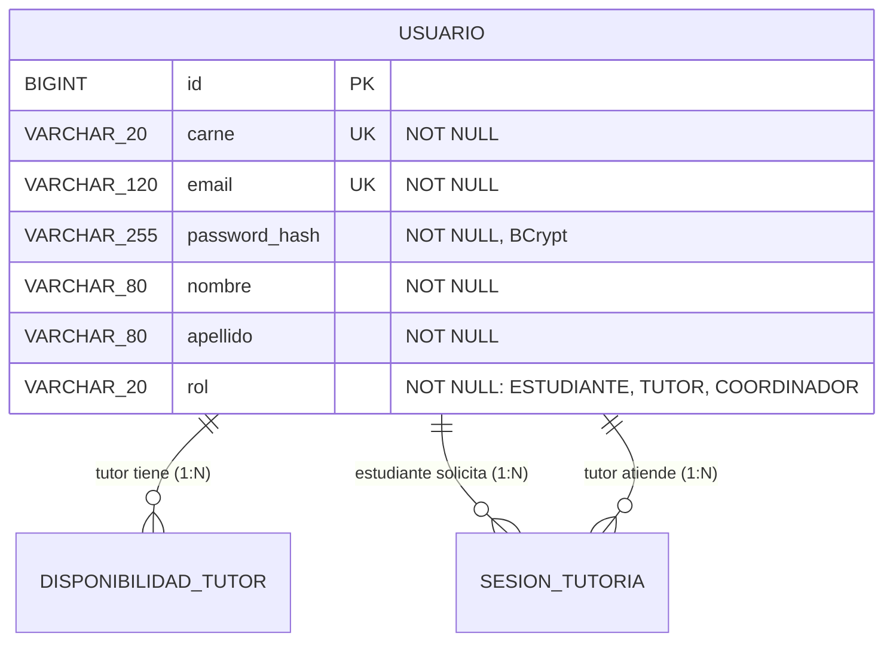

# Modelo Entidad-Relación

Las demás entidades (Materia, DisponibilidadTutor, SesionTutoria, RecursoEstudio y EvaluacionTutoria) las agrega cada responsable en su rama; el diagrama final se integra al cierre.